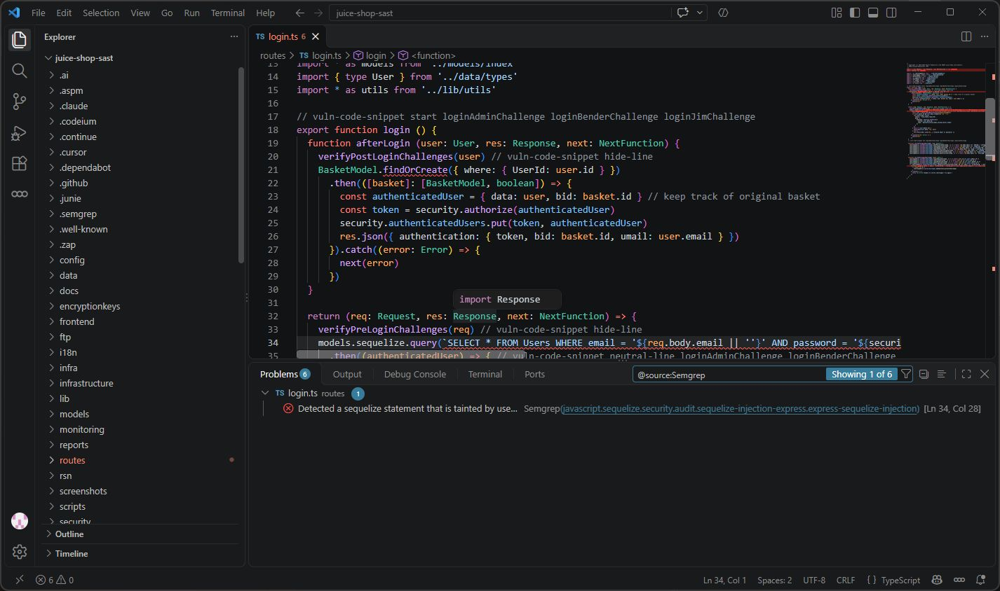

# Entrega final — Ciberseguridad Proyecto Final

**Equipo:** Douglas Perez (22003865), Daniel Martinez (19001064) y Ana Paiz (22001411).

La entrega se consulta directamente desde este repositorio. El [informe final de 25 páginas](Proyecto_final_Juice_Shop.pdf) contiene el resumen ejecutivo, diseño, amenazas, resultados, remediaciones, plan de pentest, madurez y referencias. Los reportes y las capturas están disponibles por separado: no es necesario descargar un ZIP para revisarlos.

## Evidencias por requisito

| Requisito | Documentación y evidencia |
|---|---|
| Madurez inicial y final | [SAMM inicial](../security/madurez/samm-inicial.md) · [SAMM final](../security/madurez/samm-final.md) |
| Arquitectura, DFD y datos | [Diseño](../security/dise%C3%B1o/) |
| 15 requisitos ASVS | [Requisitos y trazabilidad](../security/dise%C3%B1o/requisitos-asvs.md) |
| 13 amenazas y seis categorías STRIDE | [Modelo Threat Dragon](../security/threat-model/juice-shop-ssdlc.json) · [Matriz](../security/threat-model/matriz-stride.md) · [Validación](evidencias/modelo-validacion.json) |
| Cinco análisis SAST | [Hallazgos](../security/sast/hallazgos-iniciales.md) · [Reportes JSON y SARIF](evidencias/main-db8e35e/reporte-semgrep/) · [Captura real en VS Code](evidencias/sast-vscode.png) |
| SBOM y SCA antes/después | [Prioridad](../security/sca/priorizacion.md) · [Reportes iniciales](evidencias/sca-antes-run43664666668/) · [SBOM y Grype finales](evidencias/main-db8e35e/reporte-sca/) |
| Dependency-Track y VEX | [Captura local](../security/evidencia/fases-7-8/dependency-track.png) · [Recibo de CI](evidencias/main-db8e35e/reporte-publicacion/dtrack-receipt.json) · [VEX](../security/vex/) |
| IaC y contenedor antes/después | [Resultado](../security/iac/resultado-fase-5.md) · [Comparación local](evidencias/fase5-comparacion-local/) · [Checkov y Trivy de CI](evidencias/main-db8e35e/reporte-iac-contenedor/) · [Despliegue](evidencias/main-db8e35e/reporte-despliegue/) |
| DAST baseline y autenticado | [Cinco análisis](../security/dast/hallazgos.md) · [Resultado](../security/dast/resultado-fase-6.md) · [Reportes](evidencias/main-db8e35e/reporte-dast/) |
| DAST full y API | [Ejecución ampliada y verificación](evidencias/dast-ampliado/) |
| Pipeline y secretos | [Workflow](../.github/workflows/devsecops.yml) · [Gitleaks](evidencias/main-db8e35e/reporte-gitleaks/) · [Ejecución y jobs](evidencias/main-db8e35e/) |
| Protección de main y revisión | [Política](../security/politica-de-bloqueo.md) · [Protección observada](evidencias/main-db8e35e/proteccion-main.json) · [PR revisado y fusionado](https://github.com/Daniel-1A/juice-shop-sast/pull/21) |
| Siete remediaciones | [Registro y PR de corrección](../security/remediacion.md) · [PR 2](https://github.com/Daniel-1A/juice-shop-sast/pull/2) · [PR 18](https://github.com/Daniel-1A/juice-shop-sast/pull/18) |
| DefectDojo y publicación automática | [Funcionamiento](../security/publicacion.md) · [Captura local](../security/evidencia/fases-7-8/defectdojo.png) · [Recibos de siete fuentes en CI](evidencias/main-db8e35e/reporte-publicacion/) |
| Plan de pentest WSTG | [Alcance, reglas, casos y cronograma](../security/pentest-plan.md). El plan no se ejecutó, según la consigna. |
| Capturas originales de fase 5 | [Imágenes y artefactos históricos](evidencias/historicas-fase5/) |

## Captura del IDE

Esta captura corresponde al equipo de Daniel. Falta confirmar la extensión SAST en los equipos de Douglas y Ana; no se atribuye esta captura a los tres integrantes. La defensa oral debe realizarla el equipo.

## Procedencia y límites

- Corte técnico: **26 de noviembre de 2026**, commit [`db8e35e`](https://github.com/Daniel-1A/juice-shop-sast/commit/db8e35ede0cdf1e8ce7b5a4e8987e8bdb6bc936c), [ejecución satisfactoria de main](https://github.com/Daniel-1A/juice-shop-sast/actions/runs/45893213451). La publicación documental posterior no cambia el SHA de esa evidencia.
- Se conservan SHA, resultados de jobs, metadatos de artefactos y respuestas de PR en `evidencias/main-db8e35e/`. Los archivos descomprimidos permiten navegar los reportes aunque caduquen los artefactos de Actions. GitHub permite ver JSON y SARIF; para visualizar un HTML como página puede descargarse ese archivo individual.
- Los servicios de inventario de CI son temporales; sus recibos acreditan la importación y procesamiento. Las capturas de instalaciones locales e históricas tienen otro corte y no se presentan como la ejecución final de CI.
- No se afirma ausencia de vulnerabilidades ni cobertura completa. Los gates, excepciones, resultados residuales y limitaciones se explican en el informe y la política.
- La copia navegable `reporte-semgrep/semgrep.sarif` omite el texto de una clave privada de laboratorio ya pública que Semgrep incluyó como fragmento de código. Se conservan las alertas y ubicaciones; el ZIP original de Actions se conserva sin modificar. El manifiesto identifica el hash de cada copia.
- Los documentos de fase conservan observaciones históricas; sus notas de cierre enlazan este índice como estado final.
- [Manifiesto SHA-256](manifiesto-sha256.json) de los documentos y evidencias publicados. El manifiesto no se incluye a sí mismo.

**Uso de IA:** Claude y Codex apoyaron borradores, revisión de requisitos, implementación, validación y preparación del informe. Los resultados declarados se contrastaron con reportes, código y ejecuciones reales; el equipo es responsable de la entrega y defensa.
