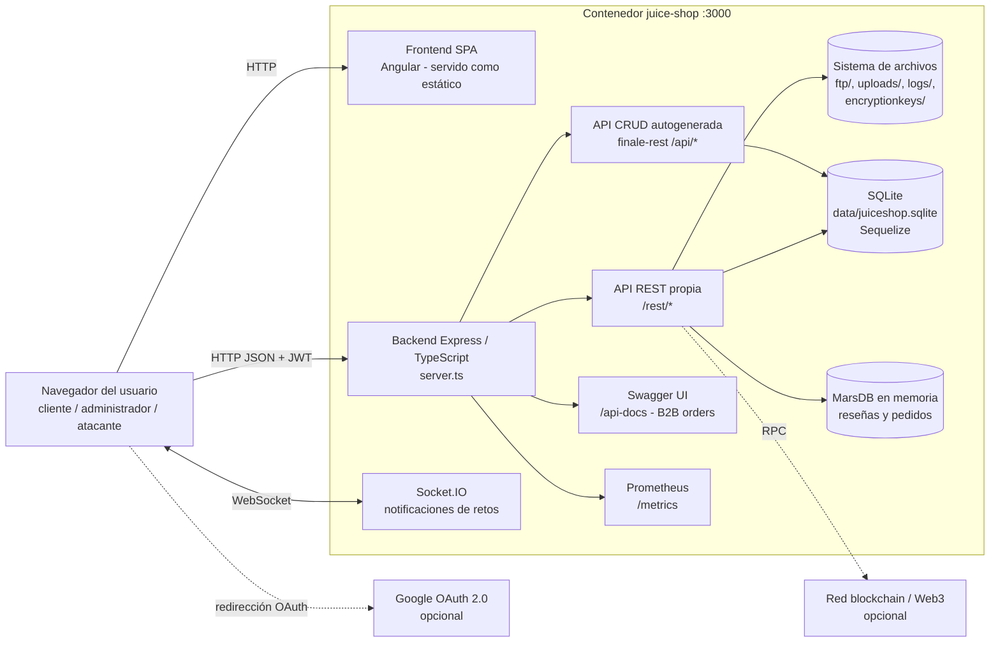
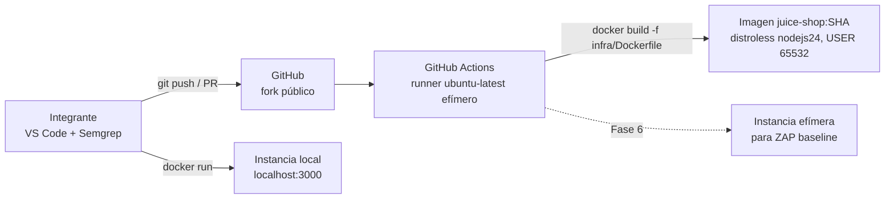

# Arquitectura - OWASP Juice Shop

> Versión analizada: Juice Shop 20.3.0 en el [commit de referencia](https://github.com/Daniel-1A/juice-shop-sast/tree/779106b4d989879992d94cbc70616a289f84713b).
> Fuente: lectura directa de `server.ts`, `models/`, `data/mongodb.ts`, `routes/`, `config/default.yml` y `Dockerfile`.

## 1. Vista de componentes

| Componente | Tecnología | Responsabilidad | Notas de seguridad |
|---|---|---|---|
| Frontend SPA | Angular | Interfaz de tienda, login, carrito, pago, perfil | El JWT se guarda en `localStorage` al iniciar sesión |
| Backend | Node.js + Express (TypeScript) | Lógica de negocio, autenticación, autorización | `helmet` solo con `noSniff` y `frameguard`; CORS abierto (`cors()` sin lista de orígenes) |
| API REST `/rest/*` | Rutas en `routes/` | Login, búsqueda, carrito, pagos, 2FA, passkeys, uploads | Contiene consultas SQL crudas y `eval()` (ver SAST) |
| API CRUD `/api/*` | finale-rest sobre modelos Sequelize | CRUD de Users, Products, Feedbacks, Cards, Addresss, etc. | Autorización aplicada por middleware antes de finale |
| Socket.IO | socket.io | Notificaciones en tiempo real | Sin datos sensibles de negocio |
| `/api-docs` | swagger-ui-express | Documentación OpenAPI de `/b2b/v2/orders` | Útil para el ZAP API scan (Fase 6) |
| `/metrics` | prom-client | Métricas Prometheus | Expuesto sin autenticación |
| SQLite | Sequelize | Usuarios, tarjetas, direcciones, carritos, billeteras, preguntas de seguridad | Archivo local dentro del contenedor |
| MarsDB | marsdb (NoSQL en memoria) | Reseñas de productos y pedidos | Se pierde al reiniciar |
| Sistema de archivos | Express static / serve-index | `/ftp`, `/encryptionkeys`, `/support/logs`, imágenes de perfil | Listado de directorios habilitado |
| Google OAuth | Servicio externo | Inicio de sesión con Google (opcional) | Client ID en `config/default.yml` |
| Web3 | Servicio externo | Retos de billetera / NFT (opcional) | Fuera del alcance de pruebas activas |

## 2. Despliegue actual y previsto

- La instancia del runner para ZAP y los servicios locales Dependency-Track y DefectDojo se incorporarán en la entrega final.
- **Entorno de pruebas:** solo contenedores propios, en la laptop de cada integrante o en el runner de GitHub Actions, que se destruye al terminar cada job. No hay despliegue en nube.
- **Imagen del equipo:** `infra/Dockerfile`, construcción multi-etapa Node.js 24 → distroless nodejs24-debian13:nonroot, ambas bases fijadas por digest, UID/GID 65532 y healthcheck sin shell. El Dockerfile original se conserva como referencia. El estado de validación real está en `security/iac/resultado-fase-5.md`.
- **Despliegue:** `infra/compose.yaml`, puerto en localhost, capabilities eliminadas, no-new-privileges y límites de CPU, memoria y procesos. La capa escribible se conserva para los archivos que genera la aplicación. No hay montajes del host ni persistencia.
- **Puertos:** 3000/TCP (HTTP sin TLS dentro del contenedor). Solo se expone a `localhost` o a la red interna del runner.
- **Persistencia:** ninguna. La base SQLite y MarsDB se regeneran con datos de semilla en cada arranque.

## 3. Supuestos y fuera de alcance
- No hay proxy inverso ni TLS; en producción se asumiría un balanceador con TLS.
- Los retos de Web3/NFT y la integración real con Google OAuth no se prueban activamente.
- Juice Shop es **vulnerable a propósito**: varios hallazgos corresponden a retos del laboratorio. La política describe cuándo bloquea cada control y cómo documentar excepciones.
