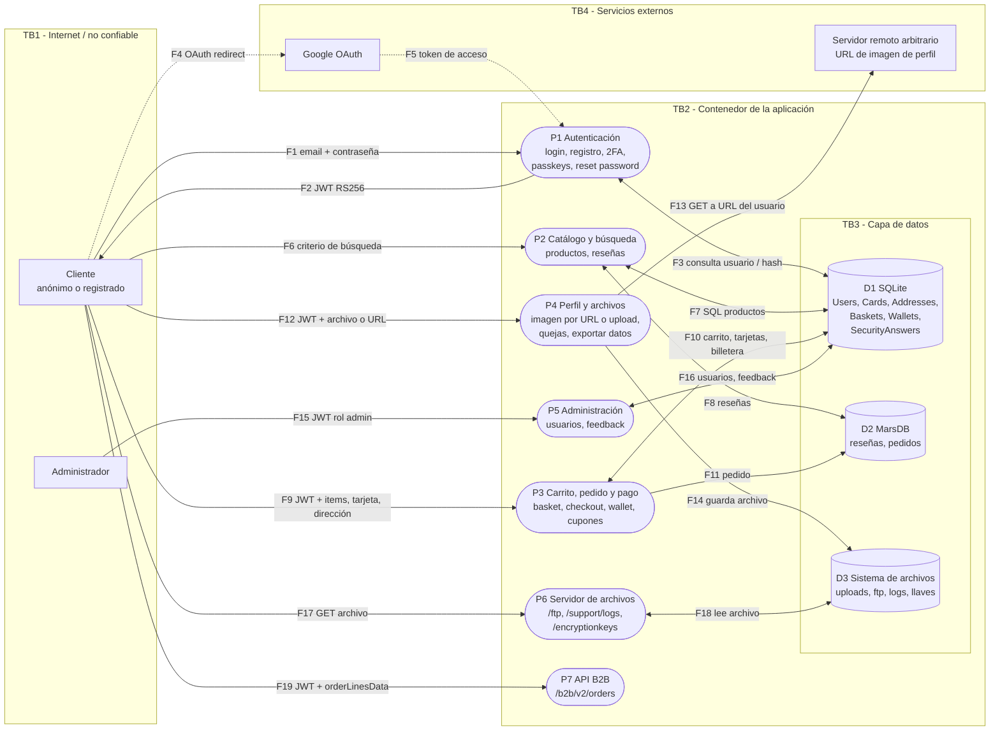

# Diagrama de flujo de datos (DFD) - Juice Shop 20.3.0

Notación: rectángulos = entidades externas, rectángulos redondeados = procesos, cilindros = almacenes de datos, subgrafos = **límites de confianza (TB)**. Este DFD es la base del modelo STRIDE en OWASP Threat Dragon (Fase 2, `security/threat-model/`).

## Elementos

| ID | Elemento | Tipo | Límite | Datos principales |
|---|---|---|---|---|
| CLI | Cliente | Entidad externa | TB1 | Credenciales, datos personales, tarjeta |
| ADM | Administrador | Entidad externa | TB1 | Credenciales con rol `admin` |
| P1 | Autenticación | Proceso | TB2 | Contraseñas, JWT, secreto TOTP |
| P2 | Catálogo y búsqueda | Proceso | TB2 | Datos públicos, texto de búsqueda |
| P3 | Carrito, pedido y pago | Proceso | TB2 | Tarjetas, direcciones, saldo de billetera |
| P4 | Perfil y archivos | Proceso | TB2 | Imágenes, archivos XML/YAML/ZIP, URLs |
| P5 | Administración | Proceso | TB2 | Lista de usuarios |
| P6 | Servidor de archivos | Proceso | TB2 | Documentos, logs de acceso, llaves |
| P7 | API B2B | Proceso | TB2 | Pedidos masivos (OpenAPI en `/api-docs`) |
| D1 | SQLite | Almacén | TB3 | Ver `clasificacion-datos.md` |
| D2 | MarsDB | Almacén | TB3 | Reseñas (autor = email), pedidos |
| D3 | Sistema de archivos | Almacén | TB3 | Uploads, logs con IP, llaves |
| GO | Google OAuth | Entidad externa | TB4 | Identidad federada |
| EXT | Servidor remoto | Entidad externa | TB4 | Contenido descargado por el servidor |

## Flujos que cruzan límites de confianza (prioridad para STRIDE)

| Flujo | Cruza | Por qué importa |
|---|---|---|
| F1, F2 | TB1 ↔ TB2 | Credenciales y token de sesión viajan por HTTP en el entorno local |
| F1/F3 y F6/F7 | TB1 → TB2 → TB3 | El login y la búsqueda incorporan entradas del cliente a consultas SQL |
| F9 | TB1 → TB2 | Datos de pago; riesgo de IDOR sobre el carrito de otro usuario |
| F12, F13 | TB1 → TB2 → TB4 | El servidor hace peticiones a URLs del usuario (SSRF) |
| F15 | TB1 → TB2 | Elevación de privilegios si el rol se toma de un JWT manipulado |
| F17 | TB1 → TB2 → TB3 | Listado de directorios y descarga de archivos internos |
| F19 | TB1 → TB2 | Datos evaluados en un sandbox `vm` (inyección de código) |
